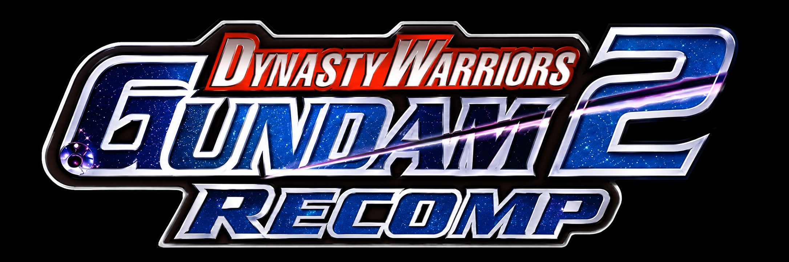
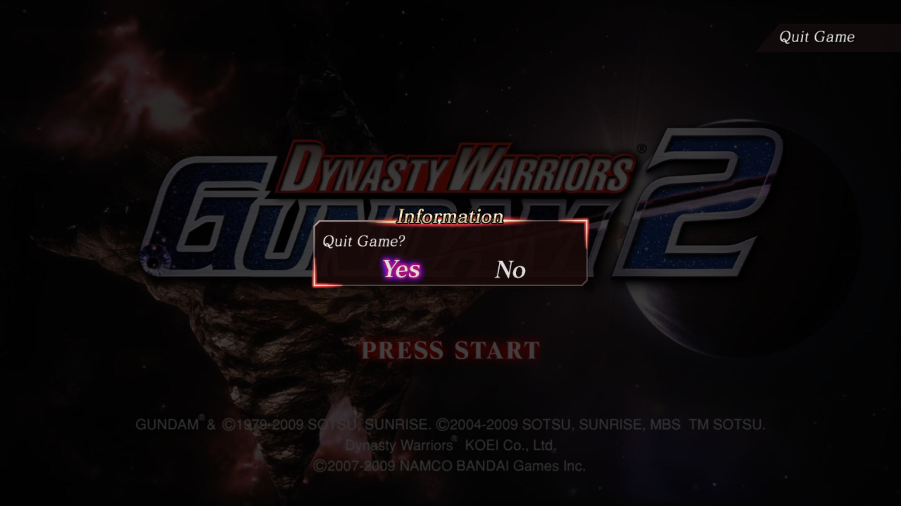
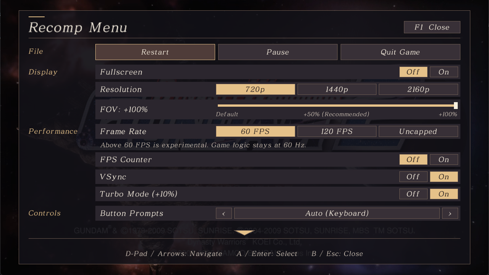
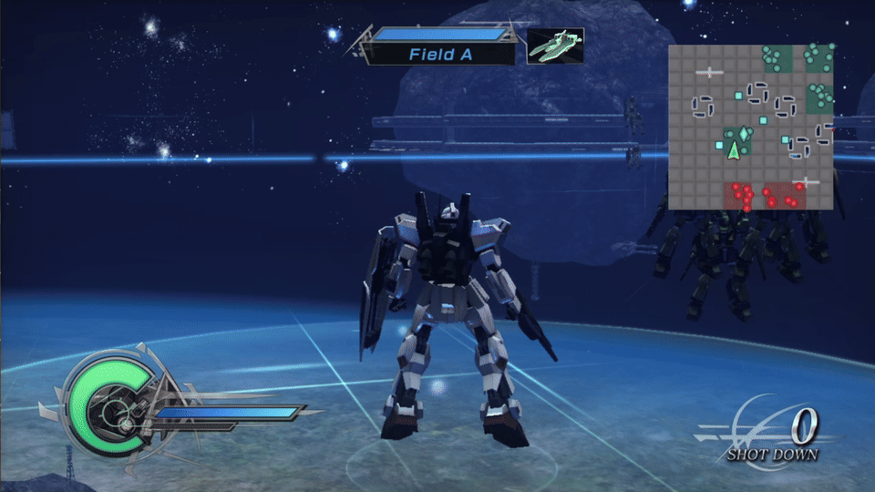

> [!NOTE]
> **AI usage disclosure:** This recompilation project was developed entirely using AI.

  

A Windows PC recompilation of Dynasty Warriors: Gundam 2.

<a href="https://github.com/Adeelshah001/DWG2Recomp/releases/latest"><strong>Download the latest release</strong></a>

## Features

- **Recomp Menu** opens with L2, LT, the PS5 touchpad, or F1. Pause and resume gameplay, or confirm Restart and Quit from the overlay.
- **Graphics options** include live 720p, 1440p, and 2160p resolution, a field-of-view slider up to +100%, VSync, and an FPS counter. Presentation above 60 FPS is experimental.
- **Custom controls** let you remap keyboard, Xbox, and PlayStation inputs and automatically switch button prompts with the active device.

## Feature previews

<table>
  <tr>
    <th width="50%">Quit Game from Title Screen</th>
    <th width="50%">Recomp Menu</th>
  </tr>
  <tr>
    <td width="50%"></td>
    <td width="50%"></td>
  </tr>
  <tr>
    <th colspan="2">Field of View: Default to +100% (+50% Shown)</th>
  </tr>
  <tr>
    <td colspan="2"></td>
  </tr>
</table>

## Requirements

- Windows 10 or 11, 64-bit.
- An x86-64-v3 CPU and a DirectX 12-capable GPU.
- Your own legally obtained, original **USA Xbox 360 ISO** of Dynasty Warriors: Gundam 2. Other regions and modified images are not supported by this build.
- A writable local folder with space for imported game data and temporary setup files.

No game files are included. No separate developer tools or SDK installation is required. Minimum performance specifications are still being tested.

## Quick start

1. Download **DWG2Recomp.zip** from the [latest release](https://github.com/Adeelshah001/DWG2Recomp/releases/latest).
2. Extract the entire ZIP into a writable folder. Keep its contents together.
3. Optionally put your supported USA Xbox 360 ISO in the **game** folder, then run **DWG2R.exe**. If no supported ISO is found there, setup asks you to choose it.
4. Allow the first-time import and preparation to finish. Later launches reuse the prepared game.
5. Press **L2**, **LT**, or **F1** to open the Recomp Menu.

Save through the game's menus before quitting or restarting. Saves and settings stay in your local installation. On v0.8.2 and later, use **Recomp Menu > Check for Updates**. Earlier versions use **Help > Check for Updates**. Save your progress before accepting the close-and-install prompt. Compatible updates keep your prepared executable or reuse cached compiled parts. Compiler/shared-interface changes can still require fuller preparation.

## Building from source

The launcher, host layer, scripts and SDK patches are all here. **No game content is
included and none is ever needed in a checkout**: the title executable is generated on
the machine that owns a supported ISO.

- [BUILDING.md](BUILDING.md) - toolchain, the pinned ReXGlue SDK, and the three build
  paths (launcher only, local runtime, player package).
- [docs/ARCHITECTURE.md](docs/ARCHITECTURE.md) - how recompilation, the preparation cache
  and the updater fit together.
- [AGENTS.md](AGENTS.md) - the same material organised for AI coding assistants.

Keep your own legally obtained USA ISO outside Git. Do not commit game data, generated
title code, compiled objects, caches, saves or logs.

## Fork, build, and publish your own updates

1. **Fork and clone.** Select **Fork** on GitHub and clone your fork. Start from `main` for current source or a release tag for a specific version.
2. **Build and test.** Follow [BUILDING.md](BUILDING.md). The launcher builds on Windows without an SDK or game files. For native code changes, use the pinned ReXGlue SDK, the documented toolchain and your own supported USA Xbox 360 dump. Test in a separate installation with a copied save.
3. **Point the updater at your fork.** Set `UpdateService.Repository` in [launcher/UpdateService.cs](launcher/UpdateService.cs) to `your-account/your-fork`, update the launcher version for your release, and rebuild. Give testers this fork-configured launcher first so **Check for Updates** reads releases from your fork.
4. **Package and publish.** Use [the player-package build path](BUILDING.md#path-3--player-package) to assemble the portable preparation files. Use the upstream release ZIP as a reference for the layout and update manifest. The full release-packaging workflow is currently maintainer-side, so assembling the capsule alone will not produce an updater-ready ZIP. Publish a GitHub release on your fork with a tag newer than the installed fork build and attach exactly one full player ZIP named `DWG2Recomp.zip` or `DWG2Recomp-<version>-player.zip`. To use the default update channel, leave the GitHub prerelease flag off. Include the corresponding project source and license notices, and keep game files and generated title code out of the package. Test **Check for Updates** from an older fork build before sharing it.

## Contributing

Bug reports, fixes and feature work are welcome; read [CONTRIBUTING.md](CONTRIBUTING.md)
first. The short version: keep game content out of the repository, keep existing player
saves and settings working, and state plainly what you tested on real hardware.

## License

This project's own source - the host layer, launcher, scripts and SDK patches - is
licensed under the **GNU General Public License v3.0**; see [LICENSE](LICENSE). That is
the same license as the other Xbox 360 recompilation projects this work builds on.

Built with [ReXGlue](https://github.com/rexglue/rexglue-sdk), based on
[Xenia](https://github.com/xenia-project/xenia). Bundled third-party components keep
their own licenses (BSD-3-Clause, MIT and others); see
[license notices](THIRD_PARTY_LICENSE.txt). Those notices are not optional: they apply to
any build you distribute.

This is an unofficial fan project. The original game, logo and trademarks belong to their
respective rights holders. No rights to the original game content are granted by this
project, and no game code, asset or executable is distributed here.
