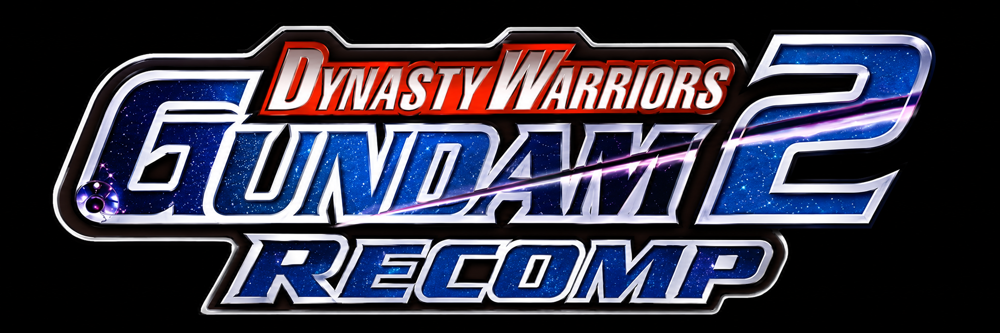
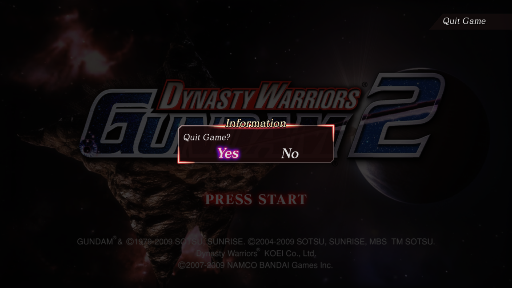
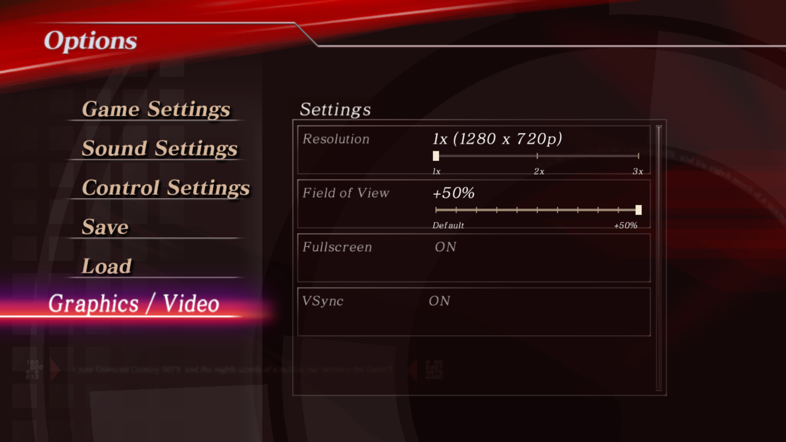
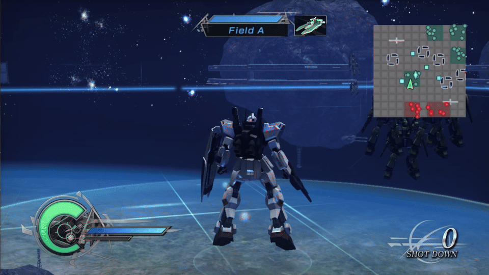

> [!NOTE]
> **AI usage disclosure:** This recompilation project was developed entirely using ChatGPT Codex (OpenAI).

  

A Windows PC recompilation of Dynasty Warriors: Gundam 2.

<a href="https://github.com/Adeelshah001/DWG2Recomp/releases/tag/v0.6-alpha"><strong>Download v06 Alpha</strong></a>

## Features

- Fixed pause-menu Graphics / Video resetting the active player profile.

- Keyboard, Xbox and PlayStation controller support with remappable controls.
- Xbox and PlayStation button prompts and controller diagrams.
- Live 1x(720p), 2x(1440p) and 3x(2160p) internal rendering and output resolution.
- Live field-of-view slider, from Default to +50%. (Experimental)
- Remembered fullscreen settings, L2/LT and F11 shortcuts, pause/resume and restart.
- One-time ISO import, prepared-game reuse and skipped startup movies.
- Incremental updates reuse unchanged compiled game parts.
- Startup save loading and automatic slot selection on supported save screens.
- Automatic update checks and **Help > Check for Updates**.
- Native-style title-screen Quit Game confirmation with B / Circle.
- In-game Graphics/Video options and one editable **settings.ini**.
- **DWG2R.exe** setup/launcher with a **DWG2R** desktop shortcut; existing shortcuts are retained on updates.
- Optional ISO detection from the **game** folder, plus frontmost setup and update progress.

**Alpha status:** Music interruptions, longer-session stability, expanded-FOV visibility and HUD issues remain under investigation. Save behavior still needs wider gameplay testing. Stable 60 FPS is not guaranteed; true 1080p/1.5x rendering is not included at the moment.

An already-affected interim checkpoint is not repaired by v06. If Restart fails or shows the wrong character, start the affected mission again from its original Official Mode or Mission Mode selection. Keep a save backup; the broader character/SP issue remains under investigation.

## Feature previews

<table>
  <tr>
    <th width="50%">Quit Game from Title Screen</th>
    <th width="50%">Graphics/Video Settings</th>
  </tr>
  <tr>
    <td width="50%"></td>
    <td width="50%"></td>
  </tr>
  <tr>
    <th colspan="2">Field of View (Default to +50%)</th>
  </tr>
  <tr>
    <td colspan="2"></td>
  </tr>
</table>

## Requirements

- Windows 10 or 11, 64-bit.
- A 64-bit CPU with SSE4.1 support and a DirectX 12-capable GPU.
- Your own legally obtained, original **USA Xbox 360 ISO** of Dynasty Warriors: Gundam 2. Other regions and modified images are not supported by this build.
- A writable local folder with space for imported game data and temporary setup files.

No game files are included. No separate developer tools or SDK installation is required. Minimum performance specifications are still being tested.

## Quick start

1. Download **DWG2Recomp.zip** from [v06 Alpha](https://github.com/Adeelshah001/DWG2Recomp/releases/tag/v0.6-alpha).
2. Extract the entire ZIP into a writable folder. Keep its contents together.
3. Optionally put your supported USA Xbox 360 ISO in the **game** folder, then run **DWG2R.exe**. If no supported ISO is found there, setup asks you to choose it.
4. Allow the first-time import and preparation to finish. Later launches reuse the prepared game.
5. Open **Controls** to configure inputs, **View** for resolution/fullscreen, or **FOV** to adjust the field of view.

Save through the game's menus before quitting or restarting. Saves and settings stay in your local installation. On v05 and later, use **Help > Check for Updates**. Save your progress before accepting the close-and-install prompt. Compatible updates keep your prepared executable or reuse cached compiled parts. Compiler/shared-interface changes can still require fuller preparation.

## License and credits

Built with [ReXGlue](https://github.com/rexglue/rexglue-sdk), based on [Xenia](https://github.com/xenia-project/xenia). Bundled third-party components retain their respective licenses; see [license notices](THIRD_PARTY_LICENSE.txt).

[License/source archive](https://github.com/Adeelshah001/DWG2Recomp/releases/download/v0.3-alpha/DWG2Recomp-v02-v03-license-source.zip) — corresponding SDK/dependency source, build definitions and host-only relink materials for v02/v03. Current v06 host/launcher additions and SDK patches are under `licenses/host-source.zip` inside the player package. **Not required to play.**

This is an unofficial fan project. The original game, logo and trademarks belong to their respective rights holders. No rights to the original game content are granted by this project.
